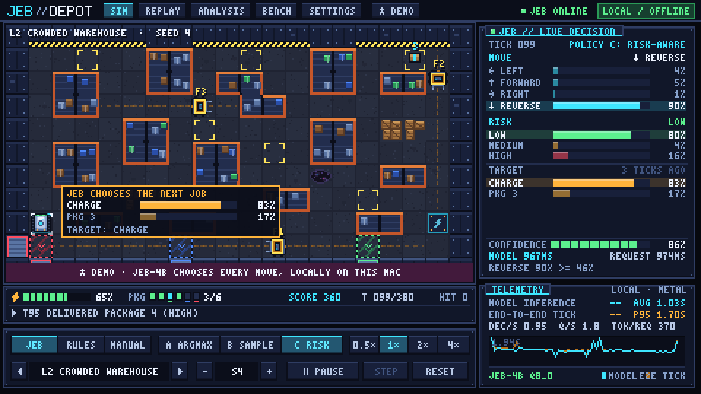
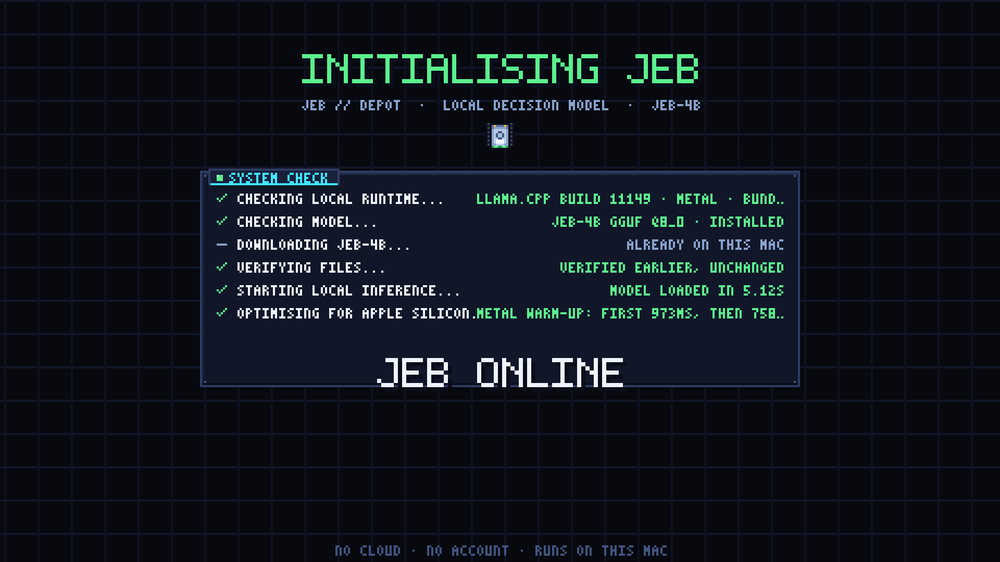
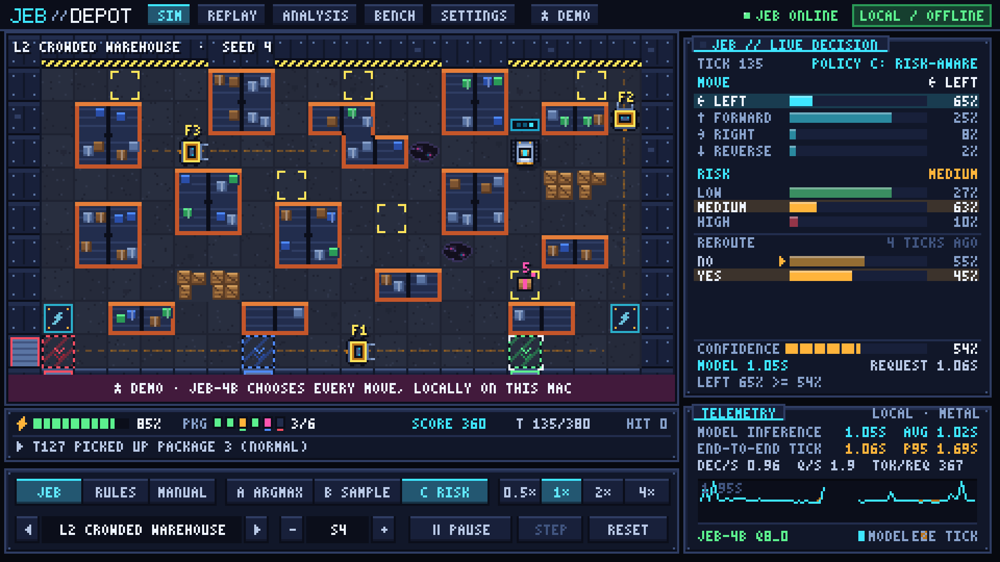
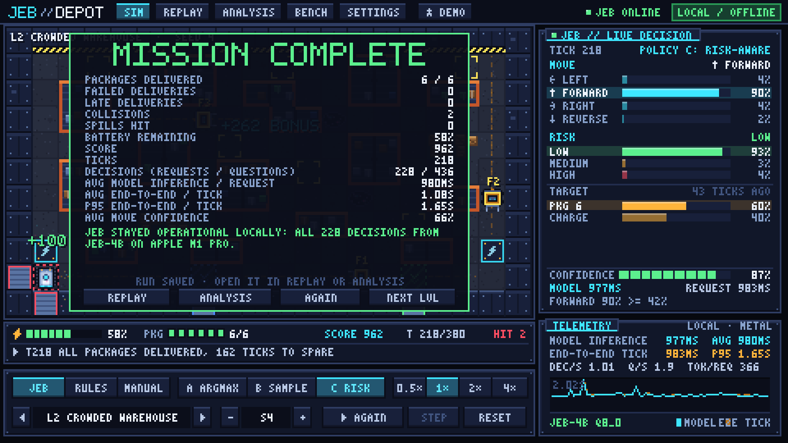
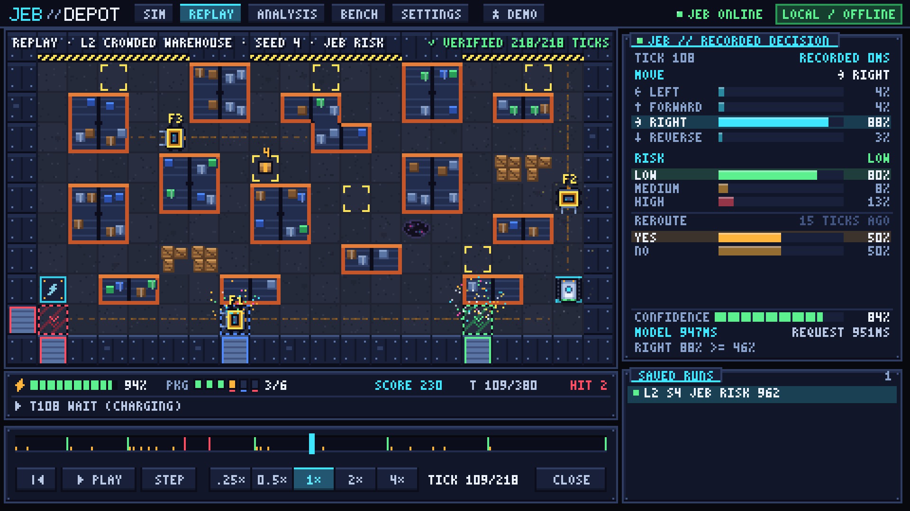
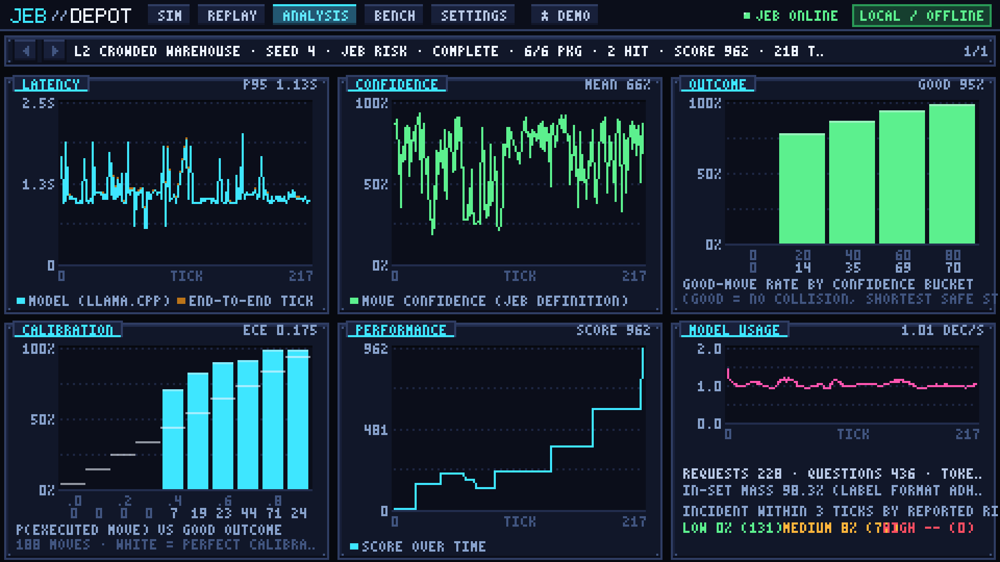
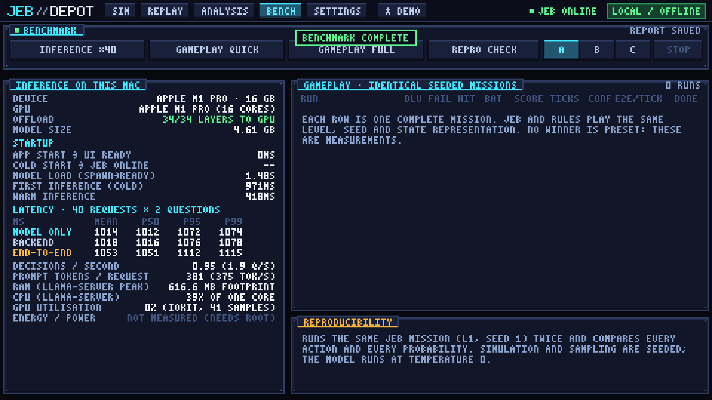
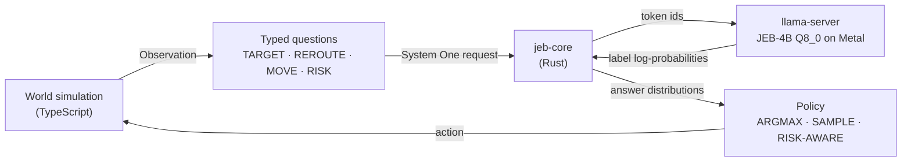

# JEB // DEPOT

**A pixel-art warehouse where every robot decision is made by a 4-billion-parameter model running locally on your Mac.**

No cloud, no account, no API key. A small robot hauls packages between pickup bays and loading docks while forklifts, oil spills and a draining battery get in the way. Each tick the game asks [JEB-4B](https://huggingface.co/szybkie-ai/jeb-4b) a few typed questions about what the robot sees, reads back a *probability distribution* for each one, and the HUD shows those probabilities live, so you can watch the model weigh its options.



<p align="center">
  
  
  
  
  
</p>

## What is this?

JEB-4B (by [szybkie.ai](https://www.szybkie.ai), fine-tuned from Qwen3.5-4B) is a **decision model**, not a chatbot. It never writes text. You give it a state and some typed questions (yes/no, a choice among options, a score on a scale) and it returns one probability distribution per question, from a single forward pass over the answer tokens. That makes it a good fit for software that needs a *calibrated probability* rather than a sentence, such as a robot deciding whether to detour around a forklift.

JEB DEPOT is a complete, playable demo of that idea:

- **A real control loop.** The simulator describes the robot's situation, asks JEB-4B what to do, turns the answer into an action and simulates the outcome. Then it repeats, once a second or so.
- **Transparent decisions.** The side panel shows every distribution JEB produced for the current tick, its confidence, and how long the model took.
- **Uncertainty that matters.** One of the three policies only acts when the move probability is high enough *for the risk JEB itself reports*, and otherwise holds position for a tick. That only works if the probabilities are honest.
- **A fair comparison.** A conventional rules-based controller plays the same seeded missions from the same observations, so JEB's behaviour can be measured against a baseline instead of just admired.
- **Fully local.** The model runs in a bundled `llama-server` on Apple's GPU (Metal), bound to loopback only. After the one-time model download the game works offline.

> This is an independent demo built on top of JEB. JEB-4B is a research model published by szybkie.ai with no warranty; this project makes no claims about its suitability for anything beyond a toy warehouse.

## Screenshots

Every image is the game's own 480×270 pixel canvas scaled 4× to 1920×1080 with nearest-neighbour filtering, which is exactly how it fills a 1080p fullscreen display. Boot and simulator frames were captured from the running app with the real model; the mission summary, replay, analysis and bench screens were rendered by the same code through the live-model test harness (`tests/tools/screens.test.ts`).

| | |
|---|---|
|  |  |
| **Boot.** Checks the bundled runtime, verifies the model against its pinned SHA-256, starts local inference and warms up Metal. | **Simulator.** Move, risk and reroute distributions for the current tick, plus latency telemetry. |
|  |  |
| **Mission summary.** Deliveries, collisions, battery and score for the run. | **Replay.** A saved run is re-simulated from its seed and verified tick by tick, with the model's original probabilities. |
|  |  |
| **Analysis.** Latency, confidence, outcome by confidence, calibration and model usage for a run. | **Bench.** Inference latency and resources on your machine (shown here), plus JEB vs RULES on identical seeded missions and a reproducibility check. |

There is also a **Settings** screen that shows what is installed and running (model, runtime build, GPU offload, memory, llama-server log tail) and offers model maintenance.

## How a tick works



Code owns the geometry (routes, distances, predicted forklift positions); the model only *judges*. Each tick has up to two decision stages, so every decision takes effect in the tick it was made:

| Stage | Question | Type | Asked when |
|---|---|---|---|
| strategic | `TARGET` | choice | at decision points with at least two real options (which job next, carry on or charge first) |
| strategic | `REROUTE` | noul (yes/no) | the planned route is blocked and a clear detour exists |
| tactical | `MOVE` | choice | every tick the robot is travelling (left / forward / right / reverse) |
| tactical | `RISK` | score | with every `MOVE` (LOW / MEDIUM / HIGH) |

### Controllers and policies

| Controller | What it does |
|---|---|
| **JEB** | Every question goes to the local JEB-4B. |
| **RULES** | A deterministic baseline built from conventional heuristics on the *same* observation: shortest-path following, yield to forklifts, avoid spills when free, value-per-step target choice with a battery reserve. Its "distributions" are one-hot. |
| **MANUAL** | You drive with WASD or the arrow keys. |

| Policy | How JEB's distributions become an action |
|---|---|
| **A · ARGMAX** | Take the most probable option of every question. |
| **B · SAMPLE** | Draw each decision from its distribution (seeded, so runs still reproduce). |
| **C · RISK-AWARE** | Act only when the move is confident enough for the risk JEB reports; otherwise hold for a tick (at most twice in a row). Detours are accepted more readily when risk is high. |

### Levels

| # | Level | What makes it hard |
|---|---|---|
| 1 | Training depot | Wide aisles, one slow forklift, no deadlines |
| 2 | Crowded warehouse | Narrow aisles, three forklifts, three docks |
| 3 | Night shift | Lights down: sensors see 3 tiles, spills appear, deadlines |
| 4 | Hard mode | Four forklifts, 55% battery, urgent deadlines |

Every mission is seeded, so the same level and seed always produce the same world. A delivery is worth its priority (low 60, normal 100, high 150, urgent 220), halved if it is late. Delivering everything earns a bonus of 100 plus the ticks left on the clock. Wall collisions cost 25 points, forklift collisions 40, oil spills 10, and running out of battery 200.

## Requirements

- An **Apple Silicon Mac** on macOS 13 or later. The bundled inference runtime is llama.cpp's official `macos-arm64` build, and the game uses Metal.
- About **5 GB of free disk** and **~5 GB of RAM** for the model (Q8_0). Developed and measured on an M1 Pro with 16 GB.
- To build from source: **Node.js 20+**, **Rust** (via [rustup](https://rustup.rs)) and the **Xcode Command Line Tools**.

## Quick start

```sh
git clone https://github.com/ADAI-ALEX/jeb-depot.git
cd jeb-depot
./scripts/build-app.sh app          # app bundle only; omit "app" to also build a .dmg
open "target/release/bundle/macos/JEB Depot.app"
```

The build script downloads the pinned llama.cpp release and verifies its SHA-256, installs the npm dependencies, and runs `tauri build`. The model itself is **not** bundled: on first launch the app shows the download size, then fetches the model (4.6 GB) and tokenizer from Hugging Face, resumes if interrupted, and only uses files whose SHA-256 matches the pin. After that it starts local inference and opens the simulator. The **★ DEMO** button runs a curated mission in one click.

### Controls

| Key | Where | Action |
|---|---|---|
| `Space` | Simulator | Start / pause (in MANUAL: wait a tick) |
| `N` or `.` | Simulator | Step one tick |
| `R` | Simulator | Reset the mission |
| `W A S D` / arrows | Simulator, MANUAL | Drive the robot |
| `Space` / `←` `→` / `N` / `Home` | Replay | Play-pause / step back and forward / restart |
| `P` | Anywhere | Save a PNG of the game screen to the app data folder |

### Development

```sh
npm install
npm run dev          # browser preview: RULES and MANUAL work; anything needing the model says so
npm run typecheck
npm test             # unit tests (the live-model tests are skipped unless JEB_LIVE=1)
cargo test -p jeb-core
```

Running against the real model from source needs the bundled runtime in place first: run `./scripts/fetch-llama.sh`, then `npm run tauri dev`.

The live-model tests drive the real JEB-4B through `jebd`, the headless driver. They never download anything themselves, so install the model once into the test data directory (`.cache/dev-data`, or `$JEB_DATA_DIR`):

```sh
./scripts/fetch-llama.sh
cargo build -p jeb-core --release --bin jebd
target/release/jebd install --data-dir .cache/dev-data --llama-bin src-tauri/resources/llama/llama-server

npm run test:jeb                                                # live mission, benchmark and failure-handling tests
SHOTS=1 JEB_LIVE=1 npx vitest run tests/tools/screens.test.ts   # render every screen to a PNG in .cache/shots
```

The app itself honours `JEB_DEPOT_DATA_DIR`, `JEB_DEPOT_AUTO_DEMO=1` (start the demo as soon as JEB is online) and `JEB_DEPOT_AUTO_SHOTS=1` (save a screenshot of the game screen every 20 seconds), which is how the boot and simulator screenshots above were captured from the running app.

## Performance

Measured on an M1 Pro (16 GB), llama.cpp b11149 on Metal, 30 distinct robot states with three questions each (`move`, `risk`, `reroute`). Raw numbers are in [`docs/benchmarks/runtime-selection.json`](docs/benchmarks/runtime-selection.json), and the Bench screen re-measures them on your machine.

| Quantisation | Size | Median tick (3 questions) | RAM (RSS) | Distance from f16 (mean TV) |
|---|---|---|---|---|
| f16 | 8.67 GB | 939 ms | 8.7 GB | 0 |
| **Q8_0 (used)** | **4.61 GB** | **946 ms** | **5.0 GB** | **0.004** |
| Q6_K | 3.56 GB | 1105 ms | 4.0 GB | 0.016 |
| Q4_K_M | 2.78 GB | 1074 ms | 3.2 GB | 0.049 |

Q8_0 was chosen because it is as fast as f16 on Metal here, half the size, and nearly indistinguishable in its answers. The smaller K-quants were *slower* on this hardware and drift further from the full-precision distributions, which matters when the game acts on those probabilities.

### Why a tick takes about a second

Qwen3.5 is a hybrid model with recurrent layers, and llama.cpp can only roll such a state back to a *context checkpoint*, not to an arbitrary prefix. Scoring every question of a request from scratch would therefore re-process the whole game state once per question. `jeb-core` instead **primes** one slot with the shared `[system][state]` prefix and then scores each question in that same slot, restoring the checkpoint each time and evaluating only the last few prefix tokens plus the question itself. On the M1 Pro that took a three-question tick from about 3.0 s to about 0.95 s, with the same prompts, the same tokens and the same scoring position, so the answers match up to floating-point noise (mean total-variation distance 9·10⁻⁵ against from-scratch scoring, no top-answer flips).

The server runs with one slot (`-np 1`) and `--cache-ram 0`, because llama.cpp's RAM prompt cache would otherwise grow by about 110 MB for every distinct robot state.

### Faithful to the official server

`jeb-core` is a Rust port of the [JEB](https://github.com/szybkie-ai/jeb) System One protocol (schema, prompt rendering, tokenisation and answer decoding). [`scripts/parity/parity_check.py`](scripts/parity/parity_check.py) runs it against the official Python server in front of the *same* `llama-server`, so any difference comes from the protocol layer and not the model. The recorded result in [`docs/benchmarks/parity-q8_0.json`](docs/benchmarks/parity-q8_0.json): 221 tokenizer test strings with 0 mismatches, byte-identical prompts and token usage across 12 requests (40 questions), and 40/40 matching top answers.

## Project layout

```
crates/jeb-core/     Rust: System One protocol port, llama-server engine and process lifecycle,
                     verified resumable model download, `jebd` headless driver
src-tauri/           Tauri 2 shell: window, commands, bundling of the llama.cpp runtime
src/sim/             deterministic warehouse simulation (grid, levels, world, observations)
src/decision/        question builders, JEB engine, RULES baseline, decision policies
src/run/             mission loop, run recording, replay, metrics, benchmarks
src/render/          software framebuffer, sprites, font, scene and particle effects
src/ui/, src/app/    widgets, input, and the boot / sim / replay / analysis / bench / settings screens
scripts/             build-app.sh, fetch-llama.sh, parity/parity_check.py
tests/               unit, live-model and screenshot tests
docs/benchmarks/     recorded measurements (runtime selection, official-server parity, prompt evaluation)
```

The whole screen is a 480×270 software framebuffer, integer-scaled to the window with nearest-neighbour filtering, so every logical pixel is an exact square and the renderer is deterministic. That is also what lets the tests render real screens in Node.

## Model source and licensing

| What | Source | Licence |
|---|---|---|
| This project's code | this repository | MIT |
| JEB-4B weights | [`szybkie-ai/jeb-4b`](https://huggingface.co/szybkie-ai/jeb-4b), round 3 (2026-09-20), fine-tuned from Qwen3.5-4B | Apache-2.0 |
| GGUF Q8_0 conversion | [`mradermacher/jeb-4b-GGUF`](https://huggingface.co/mradermacher/jeb-4b-GGUF) @ `1cd0e333`, SHA-256 `2966bfb3…` | Apache-2.0 (derived from the weights above) |
| Tokenizer | `szybkie-ai/jeb-4b` @ `e0031856` | Apache-2.0 |
| Inference runtime | [llama.cpp](https://github.com/ggml-org/llama.cpp) build b11149 (official macOS arm64 release), SHA-256 `791eb020…` | MIT |
| Protocol reference | [`szybkie-ai/jeb`](https://github.com/szybkie-ai/jeb) @ `4990c9a` | MIT |

Every download is pinned by revision and SHA-256 (see `crates/jeb-core/src/runtime/manifest.rs` and `scripts/fetch-llama.sh`). The model is downloaded to your own machine at first launch and is never committed to or redistributed by this repository.

JEB-4B is a research model: it must not be used for medical, legal, financial or safety decisions, and its probabilities are only calibrated on the data it was evaluated on. See the [model card](https://huggingface.co/szybkie-ai/jeb-4b) for its limitations. In this game it only steers a simulated robot.

## Acknowledgements

[szybkie.ai](https://www.szybkie.ai) for JEB and the System One-compatible server, [mradermacher](https://huggingface.co/mradermacher) for the GGUF conversions, [llama.cpp](https://github.com/ggml-org/llama.cpp), [Tauri](https://tauri.app) and the Qwen team.

## License

[MIT](LICENSE). The model weights and the bundled llama.cpp keep their own licences, listed above.
